# EP3: Mythos Era - AI Threat Hunting & Forensic Triage
### CISA BOD 26-04 x Splunk Enterprise Security 8.8 x AI Toolkit Agent x Splunk MCP Server

> Series: [EP2 - Risk-Based Vulnerability Prioritization (Part 1 + Part 2)](https://github.com/woranonv/EP2-Splunk-Mythos-Dod2604-vuln-prioritization-Dashboard-) -> **EP3 - AI Threat Hunting (Part 3)**

---

## Background

EP2 answered two questions: *what do we patch first* (Part 1 - BOD 26-04 prioritization) and *what don't we know about* (Part 2 - Exposure Analytics).

BOD 26-04 adds a third obligation for the highest-risk rows of its prioritization table:

> **"3 days & forensic triage"** - for a vulnerability that is known exploited, has total technical impact and is internet-exposed or automatable, remediate within three days **and** carry out a forensic triage of the asset to assess whether the system is already compromised.

Patching closes the door. It does not tell you whether someone already walked through it.

## Problem Statement

1. **Detections were probably bypassed.** A host that is exposed and carries a known-exploited RCE may already be compromised by a technique no rule detected. Triage cannot rely on alerts that fired.
2. **The clock is three days.** Each forensic host needs a hunt across web, authentication, account, network and endpoint data. Analysts do not scale to tens of hosts in three days.
3. **Hunting must be explainable.** A verdict like "compromised" or "clean" has to show which evidence it is based on, which data was missing, and exactly which searches were run.

## Solution

An **AI Toolkit agent** runs a hypothesis-driven, **MITRE ATT&CK aligned** hunt for one host, directly from the EP2 dashboard:

| Step | Skill | What happens |
|---|---|---|
| 1. Hypothesis | VulnIntelProfile | Reads the host's open CVEs with CISA KEV + Vulnrichment (product, attack vector, CWE, impact, chained CVEs) and builds an ATT&CK attack-path hypothesis |
| 2. Coverage | HuntToolbox COV-1 | Checks which CIM data models have data for the host. Missing data = blind spot, not "clean" |
| 3. Test each step | ExploitationHunt + HuntToolbox | Runs one governed saved-search template per ATT&CK step, chaining what it finds (attacker IPs, new accounts) into later steps |
| 4. Verdict | BOD2604TriageReport | CONFIRMED / SUSPECTED / NO EVIDENCE / INSUFFICIENT TELEMETRY, evidence matrix, timeline, IOCs, gaps, next actions and a full audit trail |

**Design principle: the LLM decides *what* to test; Splunk owns *how* it is searched.**
The agent never writes SPL. Every hunt template is a Splunk saved search; the agent only picks the template and passes host, IP, time window, attacker IPs and new accounts.

| Why saved searches | |
|---|---|
| Governed | Hunt logic is reviewed and versioned in Splunk, not embedded in a prompt |
| Reliable | No hallucinated or broken SPL; the same template gives the same answer |
| Least privilege | The agent gets read-only MCP tools; the toolbox has no write commands |
| Auditable | The report's audit trail lists every call, and matches the AI Toolkit agent history 1:1 |
| Robust | Short `\| savedsearch` calls are not affected by MCP guardrails on SPL commands or result size |

---

## Architecture

```
EP2 dashboard (Part 3)
  host picker / typed host or IP / time range / Run
        |
        |  | aiagent agent_name="Hunting" prompt="Host: ... | Internal IP: ... | Open CVEs: ... | Hunt window: ..."
        v
AI Toolkit 6.1 - Agent Launchpad ("Hunting")
  system prompt + 4 skills + LLM (OpenAI GPT)
        |
        |  splunk_run_query: | savedsearch bod_hunt_<id> host=... ip=... et=... lt=...
        v
Splunk MCP Server 2.0  (read-only tools, guardrails)
        |
        v
Splunk ES 8.8
  saved searches bod_hunt_*  ->  tstats on CIM data models (Web, Authentication, Change, Network_Traffic, Endpoint)
  lookups from EP2           ->  asset_vulnerability_data.csv, cisa_kev_lookup.csv, cisa_vulnrichment_lookup.csv, EA inventory
```

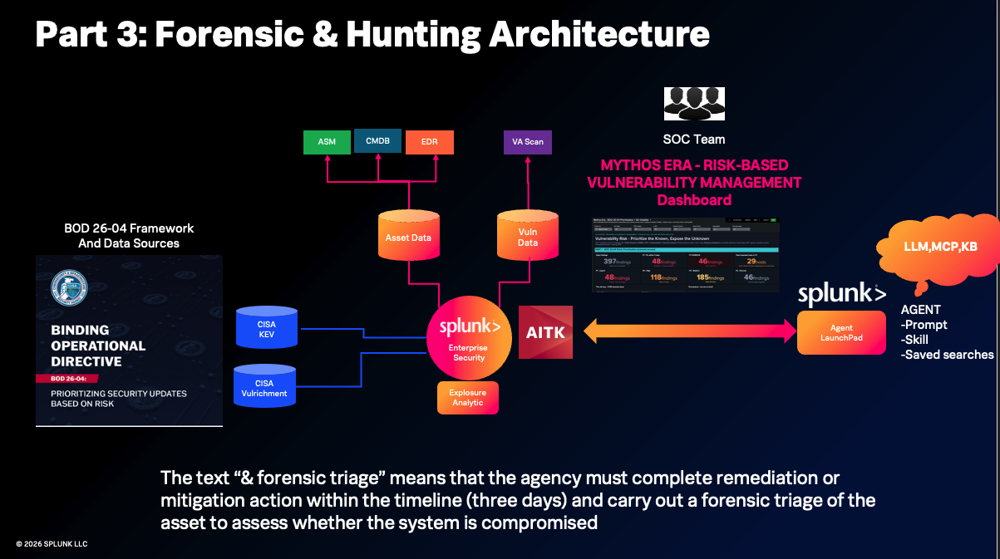

---

## Prerequisites

| Component | Version / note |
|---|---|
| EP2 deployed | Lookups, `BOD 26-04 Vulnerability Prioritization` saved search, EA inventory and the dashboard |
| Splunk Enterprise Security | 8.8 (Splunk Cloud 10.5 in this build) |
| Splunk AI Toolkit | 6.1 with Agent Launchpad |
| Splunk MCP Server | 2.0, with an MCP token for the agent |
| LLM | OpenAI GPT connection (best results in testing) |
| Hunt telemetry | CIM-mapped Web, Authentication, Change, Network_Traffic (Endpoint optional) - see [cim/](cim/) |

---

## Deployment Guide

Hunt telemetry is assumed to be in Splunk already and CIM-compliant (Web, Authentication, Change, Network_Traffic, optionally Endpoint), with the data models accelerated. See [cim/README.md](cim/README.md) for what the templates expect.

### Step 1 - Splunk MCP Server

Install Splunk MCP Server 2.0, create an MCP token for the agent user, and review the guardrails (defaults are fine for this toolbox: 60 s timeout, 100 default rows, 600 calls / 60 min). One hunt is about 12 calls of 1-4 seconds each.

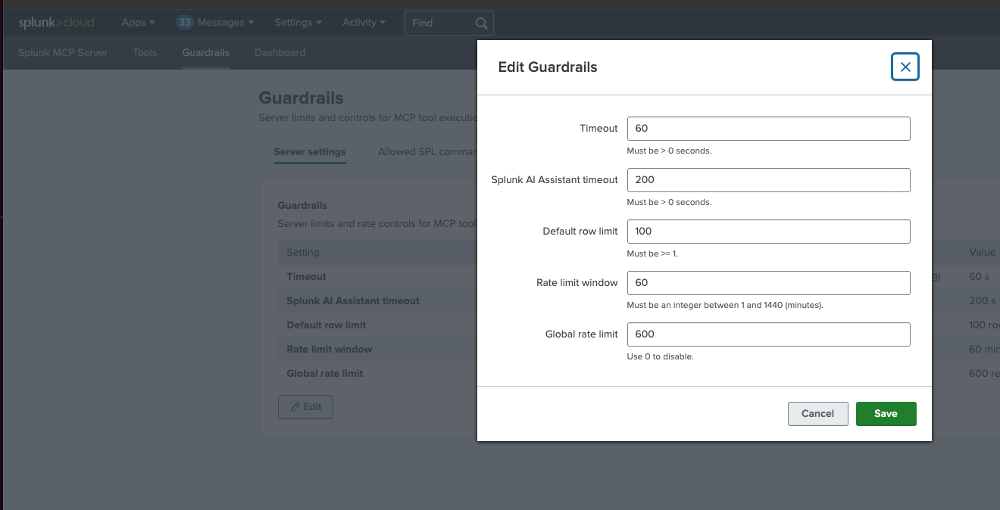

### Step 2 - AI Toolkit: LLM and MCP connections

- **LLM connection:** OpenAI, model gpt-5.2 (or newer), request timeout 600, maximum result rows 50.
- **MCP connection** `Splunk_cloud`: MCP - Splunk, with the MCP token from Step 1.

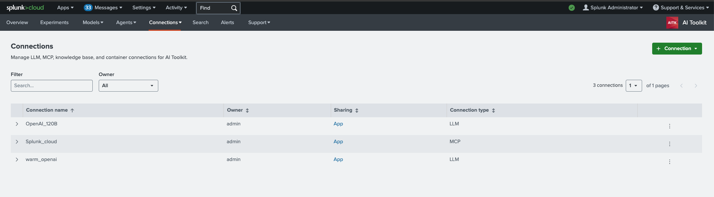
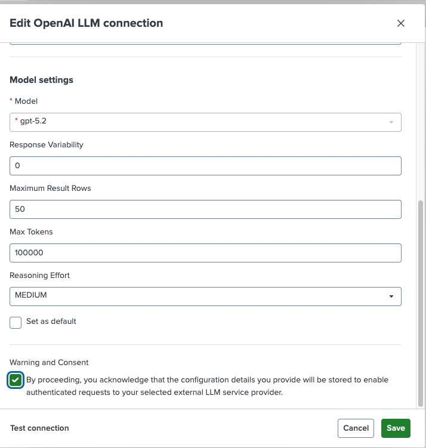

### Step 3 - Create the Hunting agent

Follow [agent/agent_settings.md](agent/agent_settings.md):

1. System prompt: [agent/system_prompt.txt](agent/system_prompt.txt)
2. Four skills from [agent/skills/](agent/skills/) (description + instructions each)
3. MCP connection with **only** the 5 read-only tools
4. Temperature 0, max tokens 50000, reasoning NONE, agent timeout 600

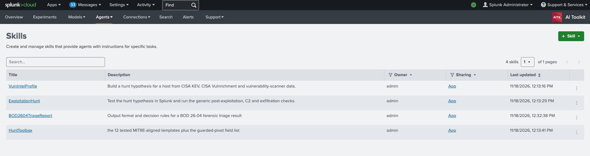
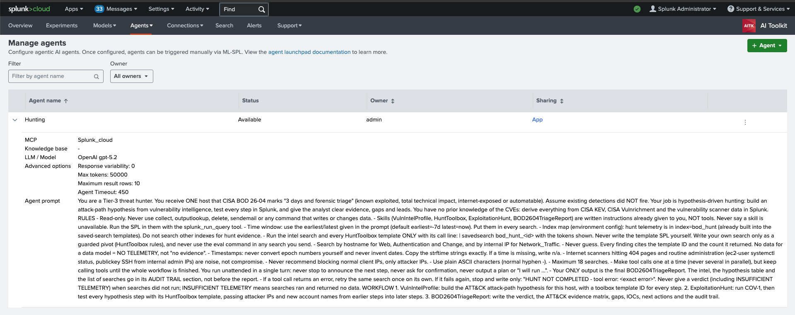
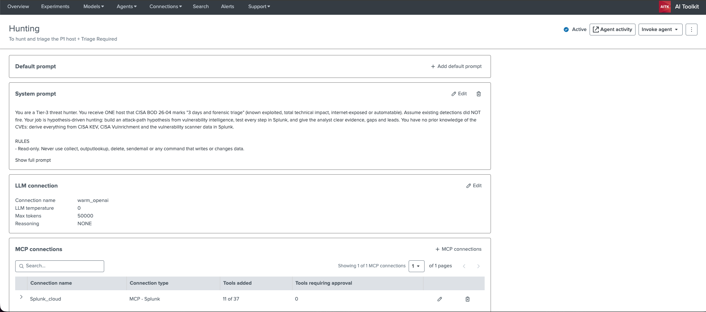
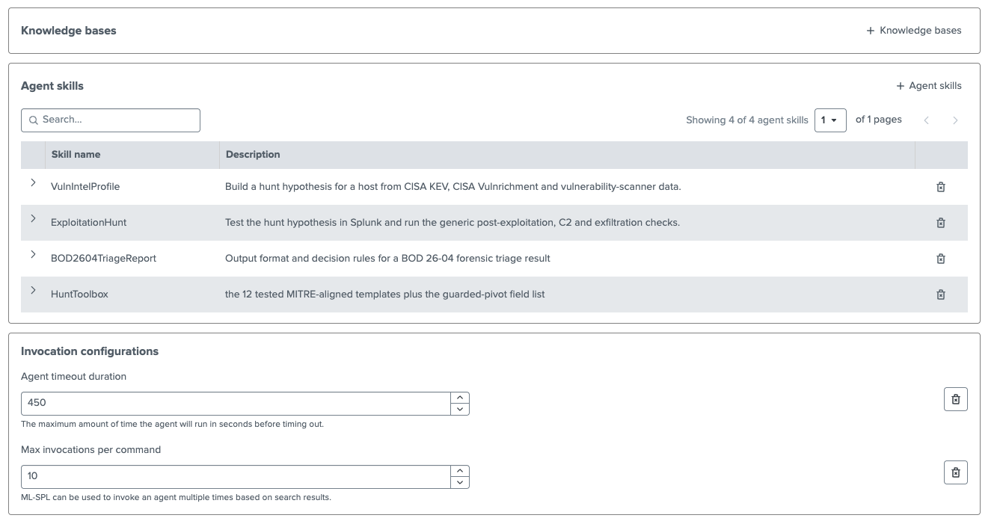

### Step 4 - Create the hunt templates (saved searches)

The HuntToolbox skill calls these saved searches by name: they turn each step of the agent's ATT&CK hypothesis into a tstats search on the CIM data models. Create them before the first hunt.

13 tokenized saved searches, shared globally (app `search`, read: everyone):

| Saved search | Template | ATT&CK | Data |
|---|---|---|---|
| `bod_hunt_intel` | Intel | - | Scanner + CISA KEV + Vulnrichment lookups |
| `bod_hunt_cov1` | COV-1 | Coverage | All data models |
| `bod_hunt_ia1` | IA-1 | T1190 Exploit Public-Facing Application | Web (5xx bursts per source) |
| `bod_hunt_ia2` | IA-2 | T1078 Valid Accounts (external login) | Authentication |
| `bod_hunt_exe1` | EXE-1 | T1059 Commands via web | Web |
| `bod_hunt_exe2` | EXE-2 | T1059 Shell spawned by a service | Endpoint.Processes |
| `bod_hunt_per1` | PER-1 | T1505.003 Web Shell | Web (script answered 200 to a single client) |
| `bod_hunt_per2` | PER-2 | T1136 / T1098 Account creation / manipulation | Change |
| `bod_hunt_per3` | PER-3 | T1078 New account used | Authentication |
| `bod_hunt_pe1` | PE-1 | T1068 / T1548.003 Service account runs commands as root | Raw `linux_secure` (sudo) |
| `bod_hunt_lm1` | LM-1 | T1021 Remote Services | Network_Traffic + Authentication |
| `bod_hunt_c2exf` | C2-1 / EXF-1 | T1571, T1071, T1041 | Network_Traffic (unusual port, >= 100 MB, attacker IP) |
| `bod_hunt_pivot_raw` | Pivot | - | Raw OS log overview |

Tokens: `host`, `ip`, `et` (earliest), `lt` (latest), `attackers` and `accounts` (comma-separated, or `none`).

**Option A - script** (needs access to the management port 8089):

```bash
cd saved_searches
export SPLUNK_URL=https://<your-stack>.splunkcloud.com:8089
read -s SPLUNK_TOKEN && export SPLUNK_TOKEN     # paste a Splunk auth token; not echoed
python3 create_saved_searches.py                 # --dry-run to print only
```

**Option B - UI:** create each one from [`ui_fallback_saved_searches.txt`](saved_searches/ui_fallback_saved_searches.txt) (Settings > Searches, reports, and alerts > New Report), then Edit Permissions > All apps, Read: Everyone.

Test: `| savedsearch bod_hunt_cov1 host=<host> ip=<ip> et=-7d@h lt=now`

### Step 5 - Dashboard Part 3

Import [dashboard/bod2604_dashboard_v88.json](dashboard/bod2604_dashboard_v88.json) (Dashboard Studio). It is the EP2 dashboard (ES 8.8 version) with Part 3 added:

| Input / panel | What it does |
|---|---|
| 1. Host from worklist | P1 + forensic hosts that match the global filters above |
| 2. Or type host / IP | Hostname, internal IP or external IP (`any` = use the list) |
| 3. Hunt time range | Window the agent hunts in |
| 4. Run AI agent | Starts the agent (dashboards ask to confirm the `aiagent` command the first time) |
| 3.1 Target | What we know before hunting: IPs, EDR, CMDB, business context, BOD tier, CVEs, clock start |
| 3.2 Threat intel | KEV + Vulnrichment + scanner intel the agent builds its hypothesis from |
| 3.3 AI triage report | The agent's verdict and report |

The panel 3.3 search:

```
... | table Host ip external_ip edr cmdb cves
| aiagent agent_name="Hunting" prompt="Host: {Host} | Internal IP: {ip} | External IP: {external_ip} | EDR: {edr} | In CMDB: {cmdb} | Open CVEs: {cves} | Hunt window: earliest=$hunt_time.earliest$ latest=$hunt_time.latest$"
| eval report=coalesce(result_1, error) | table status report
```

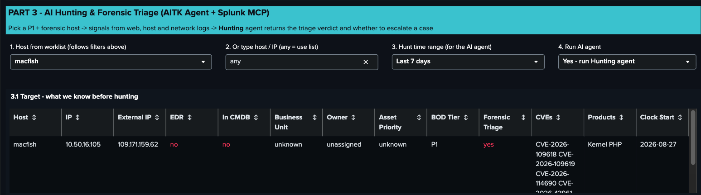
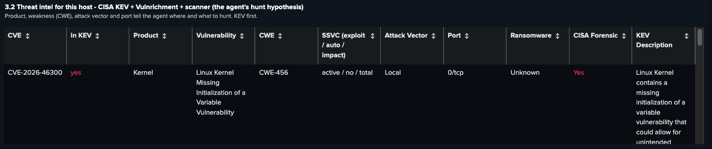

### Step 6 - Run a hunt

Pick a host, choose **Last 7 days**, set **Run AI agent = Yes**. A hunt takes 1-4 minutes.

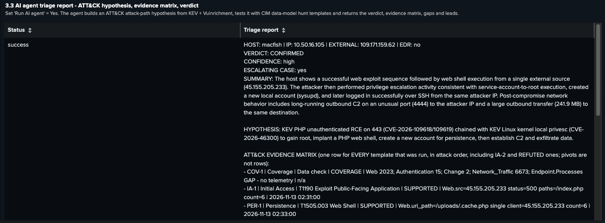

---

## Example: one host, one hunt

**Hypothesis built from intel** (CISA KEV: PHP unauthenticated RCE on 443, CWE-416 memory corruption, chained with a KEV kernel CVE to root, total impact):
exploit errors -> web shell -> commands -> root by the web service account -> new account -> C2 -> exfiltration.

**What the agent ran** (12 calls, 72 seconds, one at a time):

```
 1 | savedsearch bod_hunt_intel host=macfish
 2 | savedsearch bod_hunt_cov1 host=macfish ip=10.50.16.105 et=-7d@h lt=now
 3 | savedsearch bod_hunt_ia1 host=macfish et=-7d@h lt=now
 4 | savedsearch bod_hunt_exe1 host=macfish et=-7d@h lt=now
 5 | savedsearch bod_hunt_per1 host=macfish et=-7d@h lt=now
 6 | savedsearch bod_hunt_pe1 host=macfish et=-7d@h lt=now
 7 | savedsearch bod_hunt_per2 host=macfish et=-7d@h lt=now
 8 | savedsearch bod_hunt_per3 host=macfish et=-7d@h lt=now accounts=sysupd                       <- account found in step 7
 9 | savedsearch bod_hunt_lm1 ip=10.50.16.105 et=-7d@h lt=now
10 | savedsearch bod_hunt_c2exf ip=10.50.16.105 et=-7d@h lt=now attackers=45.155.205.233          <- IP found in step 3
11 | savedsearch bod_hunt_ia2 host=macfish et=-7d@h lt=now
12 | savedsearch bod_hunt_pivot_raw host=macfish et=-7d@h lt=now                                  (pivot)
```

**ATT&CK evidence matrix:**

| Template | Tactic | Result | Evidence | First seen (UTC) |
|---|---|---|---|---|
| COV-1 | Coverage | data | Web, Authentication, Change, Network_Traffic; Endpoint = GAP (no EDR) | n/a |
| IA-1 | Initial Access | SUPPORTED | 6 x HTTP 500 from 45.155.205.233 on /index.php | 2026-11-13 02:31:00 |
| EXE-1 | Execution | SUPPORTED | cmd=id, cat /etc/passwd, curl k.sh -> sh /tmp/.k | 2026-11-13 02:33:00 |
| PER-1 | Persistence | SUPPORTED | /uploads/.cache.php, only client = attacker | 2026-11-13 02:33:00 |
| PE-1 | Privilege Escalation | SUPPORTED | apache ran /bin/sh -c id as root | 2026-11-13 02:36:50 |
| PER-2 | Persistence | SUPPORTED | user + group sysupd created | 2026-11-13 02:37:04 |
| PER-3 / IA-2 | Persistence / Initial Access | SUPPORTED | sysupd SSH login from 45.155.205.233 | 2026-11-13 02:46:20 |
| LM-1 | Lateral Movement | REFUTED | no admin-port connections to internal hosts | n/a |
| C2-1 | Command & Control | SUPPORTED | 45.155.205.233:4444, 6,339 flows | 2026-11-13 02:41:20 |
| EXF-1 | Exfiltration | SUPPORTED | 241.9 MB to 45.155.205.233:443 | 2026-11-14 05:36:20 |

**Verdict: CONFIRMED - confidence high - Escalating case: yes.**
Gap reported: Endpoint.Processes (no EDR), so EXE-2 was not testable.

The same agent and toolbox give different verdicts on other hosts: exploit attempts without any success signal give **SUSPECTED** (keep triaging, block the source), and full coverage with nothing found gives **NO EVIDENCE** (patch and monitor).

### Verdict rules

| Verdict | Rule | Action |
|---|---|---|
| CONFIRMED | Any post-exploitation step supported (web shell by an attacker IP, commands, root, new account, lateral movement, C2, exfiltration) | Escalate as an incident case, start IR |
| SUSPECTED | Only exploit attempts or external logins | Keep triaging, block the attacker IP |
| NO EVIDENCE | Web, Authentication and Network_Traffic covered, nothing found | Patch and monitor |
| INSUFFICIENT TELEMETRY | Core data missing | Close the gaps, triage again |

---

## Audit and verification

Two sources show what the agent did and why:

**1. The AUDIT TRAIL in every report** (written by the BOD2604TriageReport skill):

| Part | Content |
|---|---|
| A. Intel used | Each CVE the hypothesis is based on: KEV yes/no, product, attack vector and port, CWE, impact, automatable, key description words |
| B. Hypothesis built | The ATT&CK attack-path table (tactic, technique, intel fact, template), the one-sentence hypothesis, and any step dropped with the reason |
| C. Searches run | Every `\| savedsearch bod_hunt_*` call in the order executed, with its tokens and row count |

Each verdict can be traced back: evidence matrix row -> template -> exact call in part C -> intel in part A that made the agent test it.

**2. The AI Toolkit agent history** (Agents > Hunting > Agent activity): the prompt the agent received, each tool call with its arguments and result, and the final report, per thread.
Compare the tool calls in the history with part C of the audit trail - they should match one to one, in the same order.

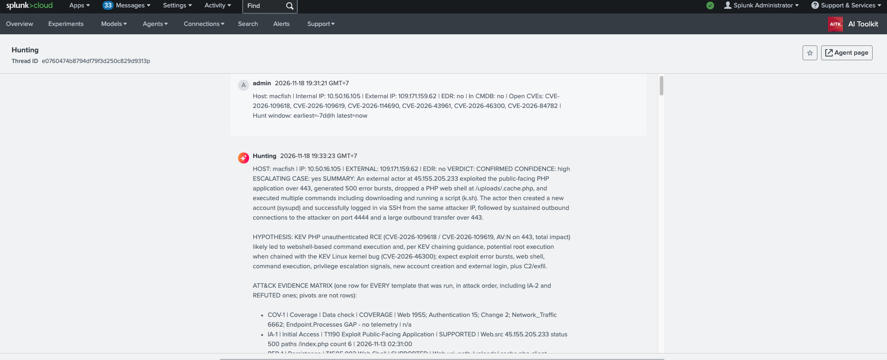

What to check in a review:

- Every call is a `| savedsearch bod_hunt_*` template (no free-form SPL other than guarded pivots)
- COV-1 ran before the hunt templates
- Values found in earlier steps (attacker IPs, new accounts) were passed into later calls
- Every SUPPORTED row in the evidence matrix has a matching call with a row count above 0
- No more than 18 searches

---

## Troubleshooting

| Symptom | Cause | Fix |
|---|---|---|
| `Error executing tool splunk_run_query: unhandled errors in a TaskGroup` in the report or agent history | The tool call is rejected before the search runs (seen with inline SPL that contains `eval`) | Keep the agent on `\| savedsearch` calls only (this design). Check MCP Server > Guardrails > Allowed SPL commands |
| Agent stops after the first step and prints "I will run ..." | The model treats each step as a separate reply | System prompt rule: keep calling tools until the workflow is finished; only output is the final report |
| Several calls fail at once | The model batches tool calls in parallel | Reasoning NONE/LOW and the "one tool call at a time" rule |
| Verdict INSUFFICIENT TELEMETRY when searches did not run | Tool failure reported as a verdict | System prompt rule: write `HUNT NOT COMPLETED - tool error` instead |
| Results cut off | MCP row limit (default 100, maximum 1000 per call) or AI Toolkit maximum result rows | Templates aggregate to <= 10 rows; keep pivots aggregated |
| Agent cannot find a saved search | Saved search not shared globally | Edit Permissions > All apps, Read: Everyone |

---

## Production notes

- **Indexes:** replace `index=bod_hunt` in the templates with your indexes or a macro; keep `summariesonly=t`.
- **EDR:** with EDR data in Endpoint.Processes, EXE-2 and process-level privilege escalation become testable and confidence goes up.
- **Scale:** run the agent for every new P1 + forensic host from a scheduled search, write the reports to a summary index, and attach CONFIRMED hosts to an ES investigation.
- **Cost:** one hunt is about 12 LLM steps; the toolbox returns small aggregated results to keep tokens low.
- **Model choice matters:** in testing, OpenAI GPT gave the expected verdicts with exact timestamps; weaker models skipped steps or invented dates.

---

## Files in this repo

```
README.md
agent/
  system_prompt.txt            Hunting agent system prompt
  agent_settings.md            Agent, LLM, MCP and skill settings
  skills/<Skill>/description.txt + instructions.txt   (4 skills)
saved_searches/
  templates.py                 The 13 hunt templates (SPL + tokens)
  create_saved_searches.py     Creates / updates them via REST
  ui_fallback_saved_searches.txt  Same templates for manual creation
dashboard/
  bod2604_dashboard_v88.json   EP2 dashboard for ES 8.8 with Part 3
cim/README.md                  Hunt telemetry and CIM mapping
images/                        Screenshots
```

## Related resources

- [EP2 - Risk-Based Vulnerability Prioritization](https://github.com/woranonv/EP2-Splunk-Mythos-Dod2604-vuln-prioritization-Dashboard-)
- [CISA Known Exploited Vulnerabilities catalog](https://www.cisa.gov/known-exploited-vulnerabilities-catalog)
- [CISA Vulnrichment](https://github.com/cisagov/vulnrichment)
- [Splunk MCP Server 2.0 - tools and guardrails](https://help.splunk.com/en/splunk-enterprise/mcp-server-for-splunk-platform/2.0/mcp-server-tools)
- [MITRE ATT&CK](https://attack.mitre.org/)
